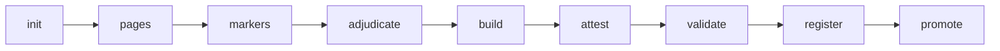

# Certified holdout intake guide

**Status: infrastructure implemented and tested; the holdout is still blocked on data.**

There are **zero certified holdout papers**. `paper-01` is the design paper and can never be
holdout evidence. The live `holdout_manifest.json` remains at
`blocked_no_certified_papers` with an empty `papers` list. Nothing in this guide has been run
against a real paper, and this workflow must not be described as production-ready until a
real intake has been completed and independently reviewed.

This guide is for:

- the **data custodian** who anonymises pages and attests to their origin;
- **markers and the adjudicator**, who need to know what a valid record contains;
- the **operator/developer** running the intake, registration and promotion commands.

The protocol rules themselves are in [CERTIFICATION_PROTOCOL.md](CERTIFICATION_PROTOCOL.md).
Dataset composition requirements are in [HOLDOUT_REQUIREMENTS.md](HOLDOUT_REQUIREMENTS.md).
The frozen experiment is in [PREREGISTRATION.md](PREREGISTRATION.md).

---

## 1. What "certified" means here

A holdout paper is usable only when all of the following are true:

1. Two **independent qualified teachers** marked every item from the anonymised pages and
   the printed scheme. Neither saw model output, the candidate reference, or the other
   marker's sheet.
2. A **separate adjudicator** resolved every criterion-level disagreement in writing.
3. Agreement is at least the pre-registered floor (Cohen's κ ≥ 0.60; 0.80 is preferred) and
   a 10% audit re-mark is complete with no discrepancies.
4. A **data custodian** attests to independent origin, anonymisation, page review, and that
   the paper is not `paper-01` or a re-encoding of it.
5. Every human attestation is backed by a **detached SHA-256 hash** of a signed form held by
   the school, outside this repository.
6. The derived reference and certification pass independent re-verification, including a
   fresh reference derivation and the frozen code digests.
7. The paper is **registered** as an immutable candidate and then **promoted** with explicit
   human approval.

Software validates evidence. It does **not** certify a paper, does not create signatures,
and does not verify who signed a form.

| Artifact | What it proves | What it does not prove |
|---|---|---|
| `certification.json` (`status: attested_pending_approval`) | all required records exist, hashes agree, κ and audit gates pass | that a named person signed, or that marking was independent in practice |
| Detached `form_sha256` | the signed form has not changed since the hash was recorded | who signed it |
| Registration candidate revision | the evidence passed every gate at registration time | that the paper is approved for the holdout |
| Promoted manifest revision | a human approved that exact revision | deployment or live activation |

---

## 2. Workflow at a glance



| Stage | Command | Requires | Writes | Changes live manifest? |
|---|---|---|---|---|
| init | `init` | valid `items.json` | workspace, `items.json`, `intake.json` | no |
| pages | `pages` | initialised workspace | `pages/student/`, `pages/scheme/`, event log | no |
| markers | `markers` | both page roles | raw + normalised marker sheets | no |
| adjudicate | `adjudicate` | two marker sheets | `adjudication.json` | no |
| build | `build` | adjudication + audit file | `reference.json`, `audit.json`, unsigned `certification.json` | no |
| attest | `attest` | built draft | `attestations/*.json`, updated certification | no |
| validate | `validate` | built package + custodian | nothing | no |
| register | `register` | attested package, custodian | immutable candidate revision | no |
| promote | `promote` | candidate revision + approval | new manifest revision file | no (new revision only) |

The workspace is `benchmark/holdout/papers/<paper_id>/`. `paper_id` must match
`holdout-NN` (for example `holdout-01`). `paper-01` is reserved and rejected.

### Workspace layout after a complete intake

```
benchmark/holdout/papers/holdout-01/
  intake.json                     stage state and paper metadata
  items.json                      custodian's printed item registry
  events.jsonl                    append-only hash-chained intake log
  pages/student/*.png|*.jpg       anonymised student pages
  pages/scheme/*.png|*.jpg        printed scheme pages
  markers/original/<role>.<hash>.json   preserved raw submissions
  markers/marker_a.json           normalised sheet
  markers/marker_b.json           normalised sheet
  adjudication.json               disagreements, resolutions, exclusions
  audit.json                      audit re-mark evidence
  reference.json                  adjudicated, not yet certified reference
  certification.json              draft or attested certification record
  attestations/marker_a.json      detached marker evidence
  attestations/marker_b.json
  attestations/adjudicator.json
  attestations/custodian.json
```

Raw submissions are preserved byte-for-byte. `history/` subdirectories hold archived
versions when the implementation is explicitly asked to replace something; the CLI does
not expose replacement.

---

## 3. Before starting

### Roles

| Role | Pseudonymous ID example | Requirement |
|---|---|---|
| Marker A | `MARKER_A_01` | qualified teacher; no access to model output, the candidate reference, or marker B |
| Marker B | `MARKER_B_01` | second qualified teacher; independent of marker A |
| Adjudicator | `ADJ_01` | separate qualified teacher or senior examiner; not marker A or B |
| Data custodian | `CUSTODIAN_01` | anonymises/reviews pages; not a marker |
| Holdout owner (promotion) | `APPROVER_01` | approves the exact candidate revision; separate from evidence creation |

Use pseudonymous IDs only. Real names, school names and contact details stay in the
school's records and never enter this repository.

### Evidence you need before the first command

- The printed item registry, independently transcribed as `items.json` (see §6.1).
- Complete anonymised student pages and complete printed scheme pages.
- Two raw marker sheets and an adjudication record.
- Audit re-mark evidence for the sampled items.
- Detached hashes of the signed marker, adjudicator and custodian forms.
- A detached hash of the holdout-owner approval form, supplied only at promotion.

### Honest prerequisites

- The student pages must contain no names, candidate numbers, school identifiers or teacher
  names. **Pixel-level anonymisation is a human responsibility**; automated text scanning
  cannot inspect handwriting or image content.
- Do not create attestations or approvals on someone else's behalf. The CLI validates
  evidence; it cannot supply it.

---

## 4. Stage reference

### 4.1 `init` — create the workspace

```bash
python -m benchmark.holdout.intake init holdout-01 \
  --items /path/to/items.json \
  --topic algebra \
  --difficulty higher \
  --marks 50
```

- **Validates** the registry: `paper_id` format and reservation, at least 25 items,
  contiguous `order` 1..N, one criterion per mark, criterion codes matching
  `^[A-Z]{1,2}[0-9][A-Za-z]{0,4}$`, no `awarded` or `expected_mark` fields.
- **Writes** `items.json`, `intake.json`, and the fixed workspace directories.
- **Optional** `--title` sets the display title; without it the `paper_id` is used.
- **Rejects** an invalid registry, an existing initialised workspace, or a reserved
  `paper-01` ID.
- `--root` (before the subcommand) changes the benchmark root; the default is
  `benchmark/`.

Do not edit `intake.json` by hand: it records which stages have run.

### 4.2 `pages` — add anonymised pages

```bash
python -m benchmark.holdout.intake pages holdout-01 \
  --role student --files /path/to/student_p01.png /path/to/student_p02.png
python -m benchmark.holdout.intake pages holdout-01 \
  --role scheme --files /path/to/scheme_p01.png
```

- **Accepts** PNG or JPEG (`.png`, `.jpg`, `.jpeg`), non-empty, at most 20 MiB.
- **Copies** into `pages/<role>/`; filenames are sanitised; the source path is not stored (only its basename is recorded as `source_name`).
- **Rejects** symlinks, duplicate content within the batch, duplicate content already stored
  under another name, and any page whose SHA-256 matches a `paper-01` page.
- Re-adding identical bytes is a no-op; adding different bytes under the same name is
  refused. There is no `--replace` in the CLI.

Both roles are mandatory before marker sheets are accepted.

### 4.3 `markers` — ingest the two independent sheets

```bash
python -m benchmark.holdout.intake markers holdout-01 \
  --role marker_a --marker-id MARKER_A_01 --file /path/to/marker_a_raw.json
python -m benchmark.holdout.intake markers holdout-01 \
  --role marker_b --marker-id MARKER_B_01 --file /path/to/marker_b_raw.json
```

- **Requires** both student and scheme pages.
- **Validates** coverage of every registry item, criterion count equal to `max_marks`,
  criterion codes in printed order, boolean awards, `kind: human_teacher`, role and marker
  ID correspondence, an ISO `signed_on`, and a declaration of at least 10 characters.
- **Preserves** the submitted bytes at `markers/original/<role>.<sha12>.json` and writes a
  normalised copy at `markers/<role>.json`.
- **Rejects** missing/extra items, unknown or duplicated criteria, reordered criteria,
  non-boolean awards, AI markers, and mismatched marker IDs.
- The second sheet must come from a **different** marker ID.

### 4.4 `adjudicate` — resolve every disagreement

```bash
python -m benchmark.holdout.intake adjudicate holdout-01 \
  --file /path/to/adjudication.json
```

- **Requires** both marker sheets.
- **Computes** the criterion-level disagreement set from the two sheets.
- **Rejects** any missing record, any record for a criterion the markers agreed on, duplicate
  records, an invalid resolution, a rationale shorter than 10 characters, and a
  `resolved_by` that is not the adjudicator.
- `resolution: "third"` requires a complete third-marker item in `third_marks`.
- `resolution: "excluded"` requires an exclusion record; an excluded item cannot be resolved
  to `a`, `b` or `third`.
- The audit sample must cover at least `max(1, 10% of items)` and contain only registry items.
- **Writes** `adjudication.json`; disagreements are never averaged or silently defaulted.

### 4.5 `build` — derive the reference and draft certification

```bash
python -m benchmark.holdout.intake build holdout-01 \
  --audit /path/to/audit.json
```

- **Requires** `adjudication.json` and an audit evidence JSON list.
- **Derives** `reference.json` from the registry, both raw sheets and the adjudication.
- **Verifies** the frozen Strategy H/evaluator/schema digests, that normalised sheets match
  their raw submissions, that the reference matches a fresh derivation, and that pages are
  present.
- **Writes** canonical `reference.json`, `audit.json`, and an unsigned
  `certification.json` with `status: "draft"` and `pending` entries.
- A κ below 0.60 or incomplete audit evidence does **not** stop the build; it appears in
  `pending` and blocks validation and registration.

Kappa is recomputed from the raw sheets; a value supplied in an input is never trusted.

### 4.6 `attest` — record detached human evidence

```bash
python -m benchmark.holdout.intake attest holdout-01 \
  --role marker_a --file /path/to/marker_a_attestation.json
python -m benchmark.holdout.intake attest holdout-01 \
  --role marker_b --file /path/to/marker_b_attestation.json
python -m benchmark.holdout.intake attest holdout-01 \
  --role adjudicator --file /path/to/adjudicator_attestation.json
python -m benchmark.holdout.intake attest holdout-01 \
  --role custodian --file /path/to/custodian_attestation.json
```

- Marker/adjudicator evidence must name the matching pseudonymous signer, use
  `kind: "human_teacher"`, an ISO date, a declaration, a valid non-placeholder
  `form_sha256`, `form_location` of `school_custody` or `external_archive`, and
  `identity_verified: false`.
- The custodian record is validated against the custodian schema (§6.7), not the teacher
  schema.
- **Rejects** wrong roles/signers, duplicate signatures, placeholder or malformed hashes,
  internal form locations, `identity_verified: true`, and identifying information in the
  declaration.
- Updating the certification writes a new file; the previous version is archived under
  `history/` rather than destroyed.
- Attestation never changes the certification to `certified`.

### 4.7 `validate` — independent package check

```bash
python -m benchmark.holdout.intake validate holdout-01
```

- Loads the paper through the paper-scoped verifier: registry/reference hashes, page hashes,
  paper IDs, item/criterion consistency, certification validity, reference re-derivation,
  kappa, audit, frozen digests and criterion-code compatibility.
- Requires `attestations/custodian.json`; a missing custodian is reported as a problem.
- Prints `{"valid": ..., "problems": [...]}` and exits `0` when valid, `1` when problems
  remain, `2` for command/prerequisite errors.
- Running `validate` does not write anything.

### 4.8 `register` — immutable candidate revision

```bash
python -m benchmark.holdout.intake register holdout-01 --dry-run
python -m benchmark.holdout.intake register holdout-01
```

- **Requires** `build` plus all three signature attestations; the custodian record must also
  exist.
- **Re-verifies** everything in `validate`, plus:
  - frozen code digests;
  - the reference `marks_available_scored` equals the `--marks` recorded at `init`;
  - no duplicate `paper_id` in the live manifest or existing revisions;
  - no reserved `paper-01` page hash and no page hash already used by another registered
    paper;
  - the projected manifest passes the full `manifest.validate_manifest` check.
- **Writes** `holdout/registrations/<paper_id>/<revision_id>.json`, where `revision_id` is
  `reg-<paper_id>-<12 hex>` derived from the revision content. The record has
  `status: "candidate"` and `paper_entry.status: "candidate"`.
- `--dry-run` runs the same gates and returns the revision payload without writing.
- **Never edits the live manifest.** A registered candidate is not a certified paper.

### 4.9 `status` and `compatibility` — inspect without writing

```bash
python -m benchmark.holdout.intake status holdout-01
python -m benchmark.holdout.intake compatibility holdout-01
```

`status` prints `intake.json` (stage flags and paper metadata). `compatibility` prints the
criterion-code report for the workspace registry, including `scoreable`, unsupported and
lossy codes, collisions and the report hash. Neither command certifies or registers
anything.

### 4.10 `promote` — human-approved manifest revision

```bash
python -m benchmark.holdout.intake promote \
  --revision holdout/registrations/holdout-01/reg-holdout-01-1a2b3c4d5e6f.json \
  --approval /path/to/approval.json
```

- **Requires** an explicit approval record (§6.8) referencing the exact `revision_id`.
- **Re-verifies** the revision content hash, the manifest base hash, frozen digests, the
  fresh paper load, certification and reference hashes, compatibility report hash,
  custodian evidence, and the full projected manifest.
- **Rejects** a changed revision, a changed manifest, changed certification/reference/
  custodian evidence, incomplete or invalid approval, and a paper already in the live
  manifest.
- **Writes** a new file `holdout/manifests/holdout_manifest.<12 hex>.json` with the paper
  entry at `status: "certified"` and a `promotion` block. `--dry-run` runs every gate and
  returns the payload without writing.
- The input manifest and candidate revision remain byte-identical.
- With 1–7 certified papers the new manifest status is `underpowered_descriptive`; with 8 or
  more it is `certified_holdout`.
- **Promotion is not deployment.** Nothing moves a live pointer or activates a run.

---

## 5. Copy-ready walkthrough

The commands assume the default benchmark root and a working directory at the repository
root. Input evidence is kept outside the repo; only the resulting workspace is inside it.

```bash
# 1. create the paper workspace
python -m benchmark.holdout.intake init holdout-01 \
  --items /secure/intake/holdout-01/items.json \
  --topic algebra --difficulty higher --marks 50

# 2. add anonymised pages
python -m benchmark.holdout.intake pages holdout-01 \
  --role student --files /secure/intake/holdout-01/student_p*.png
python -m benchmark.holdout.intake pages holdout-01 \
  --role scheme --files /secure/intake/holdout-01/scheme_p*.png

# 3. ingest the two independent sheets
python -m benchmark.holdout.intake markers holdout-01 \
  --role marker_a --marker-id MARKER_A_01 \
  --file /secure/intake/holdout-01/marker_a_raw.json
python -m benchmark.holdout.intake markers holdout-01 \
  --role marker_b --marker-id MARKER_B_01 \
  --file /secure/intake/holdout-01/marker_b_raw.json

# 4. record the adjudication and audit re-marks
python -m benchmark.holdout.intake adjudicate holdout-01 \
  --file /secure/intake/holdout-01/adjudication.json
python -m benchmark.holdout.intake build holdout-01 \
  --audit /secure/intake/holdout-01/audit.json

# 5. record detached evidence (one command per role)
python -m benchmark.holdout.intake attest holdout-01 \
  --role marker_a --file /secure/intake/holdout-01/marker_a_attestation.json
python -m benchmark.holdout.intake attest holdout-01 \
  --role marker_b --file /secure/intake/holdout-01/marker_b_attestation.json
python -m benchmark.holdout.intake attest holdout-01 \
  --role adjudicator --file /secure/intake/holdout-01/adjudicator_attestation.json
python -m benchmark.holdout.intake attest holdout-01 \
  --role custodian --file /secure/intake/holdout-01/custodian_attestation.json

# 6. check, then create the candidate revision
python -m benchmark.holdout.intake validate holdout-01
python -m benchmark.holdout.intake register holdout-01 --dry-run
python -m benchmark.holdout.intake register holdout-01

# 7. promote only after explicit approval of the exact revision
python -m benchmark.holdout.intake promote \
  --revision holdout/registrations/holdout-01/reg-holdout-01-1a2b3c4d5e6f.json \
  --approval /secure/intake/holdout-01/approval.json
```

### Corrected marker sheets

A marker's original submission is evidence. If a sheet is corrected after ingestion, the
current CLI does not silently replace it: re-ingesting different content is refused. Treat
the correction as a fresh intake path (new `paper_id`, or an explicitly reviewed new
workspace). Do not delete or overwrite the preserved raw sheet to force a revision through.

---

## 6. Record formats

All JSON is UTF-8. The implementation rejects unexpected keys in intake records; the
examples below are excerpts, not complete papers.

### 6.1 `items.json` — custodian registry

```json
{
  "paper_id": "holdout-01",
  "items": [
    {
      "id": "q1",
      "order": 1,
      "scheme_page": 1,
      "student_page": 1,
      "max_marks": 2,
      "prompt": "Expand and simplify ...",
      "criteria": [
        {"code": "M1", "text": "correct method"},
        {"code": "A1", "text": "correct answer"}
      ]
    }
  ]
}
```

Minimum 25 items; `order` must be contiguous from 1; `criteria` length must equal
`max_marks`; codes are stored verbatim; no awards or expected marks belong here.

### 6.2 Marker sheet

```json
{
  "paper_id": "holdout-01",
  "marker_id": "MARKER_A_01",
  "role": "marker_a",
  "kind": "human_teacher",
  "signed_on": "2026-11-20",
  "declaration": "I marked every item independently from the anonymised pages and the printed scheme.",
  "items": [
    {
      "id": "q1",
      "criteria": [
        {"code": "M1", "awarded": true, "note": "method visible"},
        {"code": "A1", "awarded": false, "note": "arithmetic slip"}
      ],
      "ambiguous": false,
      "illegible": false,
      "evidence": "working on page 1"
    }
  ]
}
```

Every registry item and every printed criterion must appear, in printed order. Repeated
codes are distinguished by occurrence (`M1#0`, `M1#1`) internally.

### 6.3 Adjudication

```json
{
  "paper_id": "holdout-01",
  "adjudicator": "ADJ_01",
  "kind": "human_teacher",
  "signed_on": "2026-11-21",
  "audit_sample": ["q1", "q5", "q9"],
  "disagreements": [
    {
      "item": "q4",
      "criterion": "A1#0",
      "resolution": "a",
      "resolved_by": "ADJ_01",
      "rationale": "Marker A's reading matches the printed scheme and the visible working."
    }
  ],
  "exclusions": [],
  "third_marks": []
}
```

`criterion` may be `"A1"` only when that code occurs once in the item; otherwise use the
occurrence form `"A1#0"`. `resolution` is `a`, `b`, `third` or `excluded`. A `third`
resolution needs a full third-marker item in `third_marks` with the same criteria; an
`excluded` resolution needs an exclusion record.

Allowed exclusion reasons: `source_mismatch`, `not_printed`, `scheme_missing`,
`unresolved_disagreement`. Exclusion `marks` must equal the item's printed maximum.

### 6.4 Audit re-mark evidence (`audit.json`)

A JSON **list**, one record for every item in `audit_sample`:

```json
[
  {
    "item": "q1",
    "recorded_marks": 1,
    "audit_marks": 1,
    "agrees": true,
    "note": "the re-mark matched the recorded sheet"
  }
]
```

`recorded_marks` and `audit_marks` must be between 0 and the item maximum. Any
`agrees: false`, missing sampled item, extra item, or inconsistent comparison blocks
certification.

### 6.5 Reference (`reference.json`)

Derived, never hand-authored. Scored items only; excluded items leave the denominator and
appear in `exclusions`.

```json
{
  "paper_id": "holdout-01",
  "title": "Holdout 01",
  "reference_source": "two independent human marker sheets, criterion-level adjudication; certification pending",
  "verification": {
    "status": "adjudicated_pending_certification",
    "verified_by": ["ADJ_01"],
    "verified_on": "2026-11-21",
    "warning": "Adjudicated from two independent human marker sheets. Not yet certified."
  },
  "totals": {
    "items_total": 25,
    "items_scored": 25,
    "items_excluded": 0,
    "marks_available_scored": 50,
    "candidate_marks_awarded": 41,
    "candidate_percentage": 82.0,
    "printed_marks_all_items": 50,
    "excluded_marks": 0
  },
  "derivation": {"version": 1, "criterion_kappa": 1.0, "audit_sample": 3},
  "items": [
    {
      "id": "q1",
      "max_marks": 2,
      "criteria": [
        {"code": "M1", "text": "correct method", "awarded": true, "award_source": "agreement"},
        {"code": "A1", "text": "correct answer", "awarded": false, "award_source": "marker_a"}
      ],
      "expected_mark": 1,
      "status": "scored",
      "confidence": "adjudicated",
      "evidence": "1/2 criteria awarded; sources: agreement, marker_a",
      "scheme_page": 1
    }
  ],
  "exclusions": []
}
```

`award_source` is one of `agreement`, `marker_a`, `marker_b`, `third`. Totals are recomputed
independently and checked before the record is returned. Canonical serialisation makes the
reference byte-identical for identical inputs.

### 6.6 Teacher signature evidence

```json
{
  "signer_id": "MARKER_A_01",
  "role": "marker_a",
  "kind": "human_teacher",
  "signed_on": "2026-11-20",
  "declaration": "I confirm this marking was completed independently and honestly from the anonymised pages.",
  "form_sha256": "<64 lowercase hex characters>",
  "form_location": "school_custody",
  "identity_verified": false
}
```

`form_location` must be `school_custody` or `external_archive`. `identity_verified` must be
`false`; the tooling has no identity-verification process.

### 6.7 Custodian attestation

```json
{
  "custodian_id": "CUSTODIAN_01",
  "paper_id": "holdout-01",
  "role": "data_custodian",
  "kind": "human_custodian",
  "signed_on": "2026-11-19",
  "declaration": "I confirm this paper was independently sourced, anonymised before entering the repository, and reviewed for identifying information.",
  "source_origin": "independent_series",
  "anonymisation_method": "manual redaction followed by metadata stripping",
  "source_documentation": "custody log retained by the school",
  "pixel_review": true,
  "metadata_review": true,
  "handwriting_review": true,
  "paper_not_design_paper": true,
  "understands_limits": true,
  "form_sha256": "<64 lowercase hex characters>",
  "form_location": "school_custody",
  "identity_verified": false
}
```

All five boolean claims must be `true`. `source_origin` is `independent_series`,
`school_assessment` or `external_archive`.

### 6.8 Promotion approval

```json
{
  "approver_id": "APPROVER_01",
  "role": "holdout_owner",
  "approved_on": "2026-11-22",
  "declaration": "I approve promotion of this exact registered revision after reviewing the certification and custodian evidence.",
  "revision_id": "reg-holdout-01-1a2b3c4d5e6f",
  "evidence_sha256": "<64 lowercase hex characters>",
  "evidence_location": "school_custody",
  "identity_verified": false
}
```

The `revision_id` must match the candidate exactly. Approval is supplied by the human; the
software never infers it from a successful validation.

### 6.9 Certification record

The generated record carries more provenance than the protocol's minimal example:

- `protocol_version`, `record_version`, `paper_id`, `title`, `status`, `generated_at`;
- `sources`: hashes and paths for the registry, pages, raw/normalised marker sheets,
  adjudication and reference;
- `frozen`: Strategy H/evaluator/schema digests;
- `markers` and `adjudicator`;
- `coverage` and `agreement` (kappa, threshold result, audit detail);
- `disagreements`, `exclusions`, `pending`;
- `signatures` keyed by role;
- `verification`: `method: "detached_sha256"`, `identity_verified: false`, explanatory note.

`status` is `draft` or `attested_pending_approval`. A status of `certified` is rejected:
only promotion may put a certified entry into a manifest revision.

`pending` can contain `signature:<role>`, `audit_sample`, `audit_complete` or
`criterion_kappa`. Any pending entry blocks validation and registration.

---

## 7. Certification and evidence rules

### Independence and blinding

Two different pseudonymous marker IDs are required. The same marker cannot submit twice.
Markers must not see model output, the candidate reference, or each other's sheets. The
adjudicator must differ from both.

### Agreement and audit

- Cohen's κ is recomputed over criterion-level binary awards from the raw sheets.
- κ ≥ 0.60 is the enforced floor; the protocol prefers 0.80 or above.
- Item exact agreement and mean absolute item difference are reported.
- At least 10% of items are re-marked. Any disagreement triggers a full re-check and blocks
  certification.

### Exclusions

Excluded items are not scored; their marks leave the denominator and their reason is
recorded. Allowed reasons are `source_mismatch`, `not_printed`, `scheme_missing` and
`unresolved_disagreement`. Exclusions are never converted to zero-mark scored items.

### Frozen digests

The certification records and re-verifies the seven frozen digests: Strategy H
`config.py`, `signals.py`, `runner.py`, `evidence.py`, `evaluate.py`, `evaluator.py` and
`schema.py`. A change voids the run; it is not a warning.

### Human boundary

- `build` produces a draft.
- `attest` records supplied detached evidence.
- `validate` proves internal consistency.
- `register` creates a candidate.
- `promote` requires a separate human approval.

A successful command sequence is not a teacher's signature and is not a promotion decision.

---

## 8. Registration and promotion details

### Candidate revision

Registration writes
`holdout/registrations/<paper_id>/<revision_id>.json` with:

- protocol and record versions;
- `status: "candidate"` and `paper_entry.status: "candidate"`;
- the paper metadata used at `init` (`topic`, `difficulty`, `marks_available`);
- page, reference and certification paths/hashes relative to the benchmark root;
- the full certification block and custodian evidence;
- the compatibility report and its hash;
- `manifest_base_sha256`, a content hash and the revision ID;
- `approval: null`.

The revision is immutable in normal operation. Its content hash is recomputed on load; an
edited revision is rejected before promotion.

### Promotion

Promotion writes a new `holdout/manifests/holdout_manifest.<digest>.json`. It contains the
existing papers plus the promoted entry at `status: "certified"` and a `promotion` block
recording the revision, approver ID, approval evidence hash, timestamps and the base
manifest hash.

The live `holdout_manifest.json` is **not** changed. Moving the live pointer or deploying a
run is a separate operational decision that this tooling does not perform.

---

## 9. Paper-scoped scoring compatibility

A paper is always named explicitly. There is no global "current paper" and no fallback to
`paper-01`.

- `benchmark.holdout.paper.load_paper(paper_id, root=..., papers_dir=...)` and
  `load_workspace(workspace, paper_id=...)` load the workspace's registry, reference,
  certification, pages and exclusions.
- Holdout loading checks registry/reference hashes against the certification, page hashes,
  matching paper IDs across artifacts, unique item IDs, criterion counts and order,
  expected marks, totals and exclusion consistency. A modified or mixed artifact raises
  `PaperError`.
- `benchmark.holdout.scoring.evaluate(paper, run)` passes the verified reference explicitly
  to the frozen evaluator. No scoring semantics changed.
- `python -m benchmark.holdout.intake compatibility holdout-01` prints the criterion-code
  report.

### Criterion codes

| Code | Classification | Scoreable? |
|---|---|---|
| `M1`, `M2`, `A1`, `A2`, `B1`, `B2` | exact | yes |
| `M1dep` (any supported base + `DEP`) | approved dependency alias | yes |
| `C1`, unknown base codes | unsupported | **no** |
| `M1x` or another lossy alias that normalises to a supported code | lossy / collision | **no** |

Every criterion occurrence is reported; nothing is dropped or converted. Unsupported codes
block registration and scoring with a diagnostic. `ft`, `C1`-style and other conventions
remain blocked until a **separately approved** scoring change is made. Do not modify
`_normalize_code` as a workaround: it is frozen, and changing it invalidates the
pre-registered run.

### Legacy `paper-01`

`paper.load_paper("paper-01")` is available only as an explicit legacy read, verified
against the reserved reference and page hashes. Its registry is reconstructed from the
candidate reference, and it is marked `holdout_eligible: False`. It cannot be registered as
holdout evidence.

---

## 10. Privacy and custody

- **No student-identifying information may enter the repository**: no names, candidate
  numbers, school identifiers, contact details or teacher names.
- Pages are stored as anonymised copies only. Original scans and PDFs stay outside.
- The implementation scans human-written text fields for common identifier patterns
  (email addresses, phone-like strings, labelled candidate/student identifiers, name/school
  labels). This is **heuristic** and cannot inspect pixels or handwriting.
- **Pixel-level anonymisation is a human custodian responsibility**, recorded by the
  custodian attestation (`pixel_review`, `metadata_review`, `handwriting_review`).
- Detached SHA-256 hashes prove a form's **integrity**, not the signer's identity. No
  identity-verification process is implemented, and every record carries
  `identity_verified: false`.
- Never attach real names to pseudonymous IDs in repository files. Keep the mapping in the
  school's records.

---

## 11. Limitations and known issues

1. **Unsupported criterion-code conventions.** `ft`, `C1`-style and other non-M1/A1/B1
   conventions are blocked. This is an intentional safety restriction, not a silent
   conversion. Note that [HOLDOUT_REQUIREMENTS.md](HOLDOUT_REQUIREMENTS.md) asks for papers
   with `ft` conventions; such papers cannot currently be registered until a separately
   approved scoring extension exists.
2. **No live-pointer movement.** Promotion writes an immutable manifest revision; it does
   not update `holdout_manifest.json`, activate a deployment or start a run.
3. **Candidate versus promoted status.** Registration persists `status: "candidate"`.
   Validation of the projected manifest is an in-memory check only; it does not certify the
   paper.
4. **Identity is not verified.** Detached hashes prove integrity only. `identity_verified`
   must remain false.
5. **Legacy `paper-01` is ineligible.** Its registry is reconstructed from the candidate
   reference and it is the design paper.
6. **Corrected marker sheets need a fresh intake path.** The CLI refuses to replace
   different content; preserved evidence must not be overwritten.
7. **Zero certified papers.** The holdout is blocked on data and has not been exercised on a
   real paper. Do not describe it as production-ready.
8. **Privacy scanning is heuristic.** Image-level anonymisation cannot be verified
   automatically.
9. **Projection is not certification.** The projected manifest used at registration is a
   gate check; only promotion creates a certified entry in a manifest revision.

---

## 12. Troubleshooting

| Symptom / message | Likely cause | Remedy |
|---|---|---|
| `holdout-01 has not been initialised` | command run before `init` | run `init` first |
| `holdout-01 is already initialised` | workspace exists | use a new `paper_id`; do not hand-edit state |
| `at least 25 items are required (found N)` | too few items | transcribe the full printed paper |
| `criteria count N does not match max_marks M` | registry transcription error | fix the registry entry |
| `duplicate item id` | repeated registry/row id | give each printed item a unique id |
| `page is not a PNG or JPEG image` | wrong file type | supply anonymised PNG/JPEG pages |
| `duplicate page content` / `already stored as` | same bytes added twice | remove the duplicate input |
| `page hash matches a reserved paper-01 page` | paper-01 scan reused | source an independent paper; never re-encode paper-01 |
| `missing item 'qN'` / `expected N criteria, found M` | incomplete marker sheet | mark every item and criterion |
| `unknown or duplicated criterion` | wrong code or extra criterion | match the printed registry exactly |
| `criterion ... expected ... (order matters)` | criteria out of printed order | reorder method then accuracy |
| `awarded must be a boolean` | `0/1` or text used | use `true`/`false` |
| `marker kind must be human_teacher` | AI or other marker kind | a human teacher must mark |
| `missing adjudication for X/Y` | disagreement not resolved | add exactly one record |
| `no disagreement for X/Y` | record invented for an agreed criterion | remove it |
| `requires third-marker marks` | `third` resolution without a third sheet | supply the complete third-marker item |
| `requires an exclusion record` | `excluded` resolution without exclusion | add the exclusion with reason and marks |
| `reference total <key>=... does not match the recomputed ...` | hand-edited or inconsistent totals | rebuild the reference; do not edit totals |
| `expected_mark disagrees with its criteria` | an award count and its criteria disagree | rebuild; never patch the total by hand |
| `reference.json does not match a fresh derivation from its inputs` | reference changed after build | rebuild from the preserved sheets |
| `audit re-mark disagrees for qN` | the 10% audit found a transcription/arithmetic error | re-check the whole sheet before rebuilding |
| `criterion kappa ... is below 0.6` | agreement below the enforced floor | re-mark or resolve; do not lower the threshold |
| `paper_id 'holdout-01' is already registered` | a candidate revision exists for this ID | inspect the revision; never overwrite it |
| `missing detached signature evidence for adjudicator` | attestation not supplied | run `attest --role adjudicator` |
| `certification is not attested` | signatures or pending gates incomplete | complete attestations; fix κ/audit |
| `hash mismatch` / `certification changed since registration` | artifact edited after its hash was recorded | restore the original; otherwise start a fresh intake |
| `frozen file missing` / `frozen file changed since pre-registration` | wrong `--root` or frozen code changed | use the repository root; changing frozen code voids the run |
| `unsupported codes: C1` | scorer cannot pair the code | do not register; a scoring extension needs separate approval |
| `lossy mappings: M1x` / `mapping collisions` | code would be silently normalised | correct the printed code or exclude the item honestly |
| `custodian attestation is missing` | custodian step skipped | obtain and `attest --role custodian` |
| `custodian.pixel_review must be true` | review claim missing | the custodian must review and attest honestly |
| `promotion requires explicit approval evidence` | no/malformed approval | supply §6.8 approval; do not infer it |
| `approval revision_id does not match` | approval for a different revision | approve the exact revision ID |
| `manifest changed since this candidate was registered` | live manifest edited after registration | re-register against the current base |
| `page hash already registered by ...` | page reused from another paper | use distinct pages and hashes |

Run `python -m benchmark.holdout.manifest --check-code` to verify the frozen code and live
manifest state. It should report zero certified papers while the holdout is blocked.

---

## 13. Related documents

- [papers/README.md](papers/README.md) — directory rules and quick start.
- [CERTIFICATION_PROTOCOL.md](CERTIFICATION_PROTOCOL.md) — the human certification rules.
- [HOLDOUT_REQUIREMENTS.md](HOLDOUT_REQUIREMENTS.md) — composition and dataset requirements.
- [PREREGISTRATION.md](PREREGISTRATION.md) — frozen experiment, metrics and stop rules.
- [DATASET_AVAILABILITY.md](DATASET_AVAILABILITY.md) — verified availability audit.
- [../README.md](../README.md) — benchmark overview and status.
- [../ground_truth/REVIEW_SHEET.md](../ground_truth/REVIEW_SHEET.md) — legacy paper-01 review
  form (not a holdout certification).
